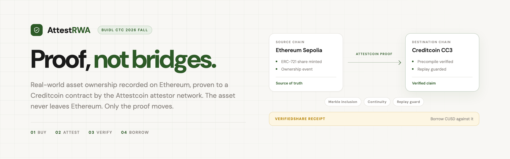
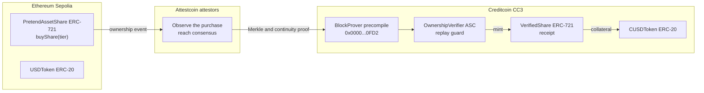
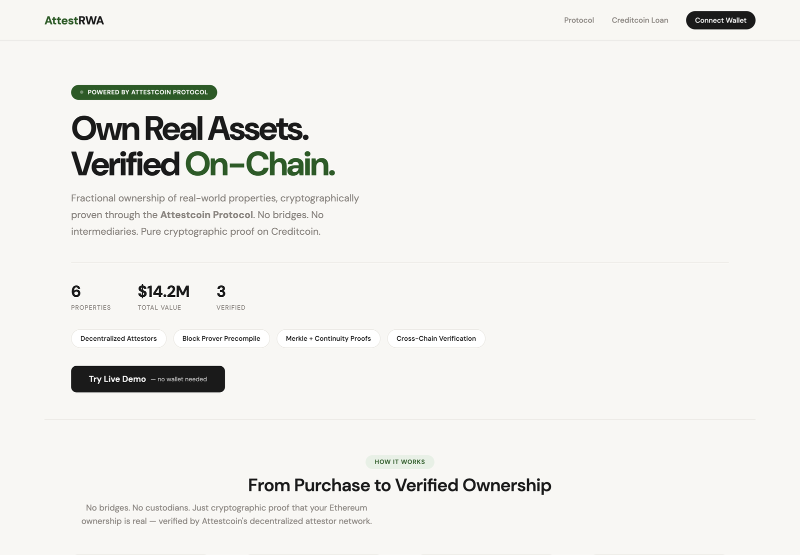
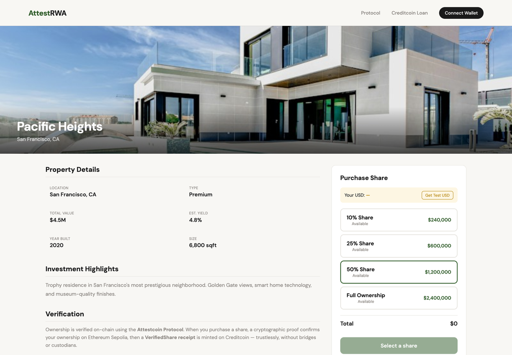

<div align="center">



<br />
<br />

<a href="LICENSE"></a>
<a href="foundry.toml"></a>
<a href="foundry.toml"></a>
<a href="https://sepolia.etherscan.io"></a>
<a href="https://creditcoin-testnet.blockscout.com"></a>
<a href="https://rwas-interoperability-uvlw.onrender.com"></a>

<br />
<br />

**Borrow against real-world assets on another chain. Proven, not bridged.**

AttestRWA proves that a real-world asset ownership event happened on Ethereum, has a Creditcoin
contract act on that proof, and mints a transferable receipt that can be used as loan collateral.
No bridge, no custodian, no wrapped asset.

</div>

> [!WARNING]
> Testnet demo built for BUIDL CTC 2026 Fall (RWA track). Not audited and not production ready.
> The verifier contract is owner-gated, and two of its checks are recorded but not enforced.
> Read [Limitations](#limitations) before you trust the happy path.

## Contents

- [What it does](#what-it-does)
- [Live demo](#live-demo)
- [How it works](#how-it-works)
- [Architecture](#architecture)
- [Screens](#screens)
- [Verification checks](#verification-checks)
- [Deployed contracts](#deployed-contracts)
- [Transactions](#transactions)
- [Tech stack](#tech-stack)
- [Repository layout](#repository-layout)
- [Quickstart](#quickstart)
- [Environment variables](#environment-variables)
- [Scripts](#scripts)
- [API](#api)
- [Limitations](#limitations)
- [Roadmap](#roadmap)
- [Security](#security)
- [Contributing](#contributing)
- [License](#license)

## What it does

The demo deploys a mock ERC-721 on Ethereum Sepolia that represents fractional ownership of real
estate, and a set of contracts on Creditcoin CC3. When someone buys a share, the purchase is
proven cross-chain with Attestcoin, and `OwnershipVerifier` mints a `VerifiedShare` receipt on
Creditcoin.

The receipt is not the asset. Ethereum stays the source of truth. The receipt is a timestamped,
re-verifiable read of that truth, transferable on Creditcoin, and usable as collateral for CUSD.

The building blocks are intentionally small: one asset token, one receipt token, one verifier, one
test stablecoin, and a Node API that drives the proof flow.

## Live demo

[rwas-interoperability-uvlw.onrender.com](https://rwas-interoperability-uvlw.onrender.com)

No wallet, gas, or setup is required. Click **Try Live Demo** and the server runs the full loop
against testnet: buy a share, wait for attestation, verify the proof, and mint the receipt. You can
also open any property and buy a share with test USD.

The Render free instance may take a minute to wake after a period of inactivity.

## How it works

1. **Buy.** A buyer purchases a share of a property on Sepolia. `PretendAssetShare` mints an
   ERC-721 and `USDToken` records the test payment.
2. **Attest.** Attestcoin attestors observe Ethereum, reach consensus on the block, and produce a
   Merkle inclusion proof plus a continuity proof.
3. **Verify.** The proof is checked against Creditcoin's BlockProver precompile, then submitted to
   the `OwnershipVerifier` ASC on Creditcoin.
4. **Mint.** The ASC records the proof and calls `VerifiedShare.mint`, which creates a receipt that
   points back to the source chain, block height, and transaction hash.
5. **Borrow.** The receipt can be used as collateral for CUSD, a test stablecoin on Creditcoin.

Ethereum remains the source of truth at every step. The receipt does not replace, transfer, or
migrate the asset.

## Architecture



The ASC is the only contract that can mint receipts, and it is `onlyOwner`. The proof is checked
with the precompile by the SDK before the owner submits the verification, which is the main
trust assumption in the current design. See [Limitations](#limitations).

## Screens

| Landing | Available properties |
| :---: | :---: |
|  |  |

<p align="center">
  
</p>

Screenshots are from the live site on testnet, using the sample properties and test balances.

## Verification checks

The flow has several checks, but they are not enforced in the same place. This table is the
per-check view.

| Layer | Check | Enforced by |
| --- | --- | --- |
| Cryptographic | Merkle inclusion | BlockProver precompile, queried by the SDK before submission |
| Cryptographic | Continuity | BlockProver precompile, queried by the SDK before submission |
| Cryptographic | Source chain key (Sepolia = 1) | Passed by the SDK and stored by the ASC |
| Precompile | Source transaction succeeded | ASC reverts with `SourceTxFailed` |
| ASC | Replay guard | `processedQueries` mapping, reverts on reuse |
| ASC | Wallet owns the asset | Recorded as true by the owner call, not read from the proof |
| ASC | Mint time window | Computed and stored, not enforced |
| ASC | Approved minter | Computed and stored, not enforced |

The demo goes deeper than a single flag check, but the on-chain gate is still thinner than the
architecture diagram suggests. That is the first thing to fix, not a detail to bury.

## Deployed contracts

| Contract | Chain | Address |
| --- | --- | --- |
| PretendAssetShare (ERC-721) | Ethereum Sepolia | [`0xaDc10fb365d504214Ae54F929C8aC837E84B2fED`](https://sepolia.etherscan.io/address/0xaDc10fb365d504214Ae54F929C8aC837E84B2fED) |
| USDToken (ERC-20) | Ethereum Sepolia | [`0xc2F8871ef47377E84A93dBEE1506AA42826399e3`](https://sepolia.etherscan.io/address/0xc2F8871ef47377E84A93dBEE1506AA42826399e3) |
| OwnershipVerifier (ASC) | Creditcoin CC3 | [`0xb67671950f7dF3a950272A6a16F0E350EC9C10af`](https://creditcoin-testnet.blockscout.com/address/0xb67671950f7dF3a950272A6a16F0E350EC9C10af) |
| VerifiedShare (receipt) | Creditcoin CC3 | [`0xaDc10fb365d504214Ae54F929C8aC837E84B2fED`](https://creditcoin-testnet.blockscout.com/address/0xaDc10fb365d504214Ae54F929C8aC837E84B2fED) |
| CUSDToken (test stablecoin) | Creditcoin CC3 | [`0x000bb049eC7B8E4DFA179928Dd5eA8F54B421FB7`](https://creditcoin-testnet.blockscout.com/address/0x000bb049eC7B8E4DFA179928Dd5eA8F54B421FB7) |

## Transactions

| Event | Chain | Transaction |
| --- | --- | --- |
| Asset mint, 10 percent share | Sepolia | [`0xd5ce04f7a1ffc4db3b5e8fe5db1f39eb97a7243e8af36e3f63a3eca3afe4ef93`](https://sepolia.etherscan.io/tx/0xd5ce04f7a1ffc4db3b5e8fe5db1f39eb97a7243e8af36e3f63a3eca3afe4ef93) |
| Proof verified and receipt minted | Creditcoin | [`0xe825787f8eb5c59082cdedffbc7edb4cc5c0d901180db35b9d96ae1655304a21`](https://creditcoin-testnet.blockscout.com/tx/0xe825787f8eb5c59082cdedffbc7edb4cc5c0d901180db35b9d96ae1655304a21) |
| Pacific Heights purchase | Sepolia | [`0x9c06c4c1b23e036dbb7187cc7db76df512928d16a080d321f7a3cda179295027`](https://sepolia.etherscan.io/tx/0x9c06c4c1b23e036dbb7187cc7db76df512928d16a080d321f7a3cda179295027) |

## Tech stack

| Component | Technology |
| --- | --- |
| Source chain | Solidity 0.8.20, ERC-721, Ethereum Sepolia |
| Destination chain | Solidity, Creditcoin CC3 testnet |
| Proof SDK | `@gluwa/usc-sdk` (ProofBuilder, PrecompileBlockProver) |
| Block prover | Native precompile at `0x0000...0FD2` |
| Backend | Node.js, Express, TypeScript |
| Frontend | Vanilla HTML, CSS, and JS in one file, ethers.js v6, DM Sans |
| Hosting | Render, auto-deploy from GitHub |
| Tooling | Foundry, npm, tsx, TypeScript |

## Repository layout

```text
contracts/                  Sepolia asset and USD token, ASC, receipt, CUSD
server/index.ts             Express API, proof flow, demo endpoints
frontend/index.html         Single-file product UI, no build step
scripts/                    Deployments, proof submission, end-to-end flows
docs/assets/                Banner, social preview, screenshots
docs/brand.html             Source for the banner and social preview
foundry.toml                Solidity build configuration
render.yaml                 Render deployment configuration
scripts/check-repo.mjs      Repository checks used by CI
.github/workflows/check.yml Typecheck, contract build, and repo checks
```

## Quickstart

Requirements: Node.js 20 or newer, npm, and Foundry for the contracts.

```bash
git clone https://github.com/maxxexee/rwas-interoperability.git
cd rwas-interoperability
npm ci
cp .env.example .env
# fill DEPLOYER_PRIVATE_KEY and the RPC URLs
npm run dev
```

Open http://localhost:3000. The same Express process serves the API and the frontend.

Contracts:

```bash
forge install foundry-rs/forge-std --no-git
forge build
```

`lib/` is gitignored, so a clean clone needs the `forge install` step before `forge build`.

To deploy your own copies, fill the contract addresses in `.env` and run:

```bash
npm run deploy
```

Use a testnet-only wallet. The deployer key signs purchases, verifier calls, and CUSD mints.

## Environment variables

| Variable | Used by | Notes |
| --- | --- | --- |
| `DEPLOYER_PRIVATE_KEY` | Server, deploy scripts | Testnet-only wallet. Signs Sepolia and Creditcoin transactions |
| `SEPOLIA_RPC_URL` | Server, deploy scripts | Ethereum Sepolia RPC |
| `CREDITCOIN_RPC_URL` | Server, deploy scripts | Creditcoin CC3 RPC |
| `CREDITCOIN_PROOF_BUILDER_URL` | Server, scripts | Attestcoin proof generation service |
| `SEPOLIA_ASSET_CONTRACT` | Server | `PretendAssetShare` address |
| `SEPOLIA_USD_TOKEN` | Server | Test USD address |
| `SEPOLIA_CUSD_TOKEN` | Server | Test CUSD address |
| `CREDITCOIN_ASC_CONTRACT` | Server | `OwnershipVerifier` address |
| `CREDITCOIN_RECEIPT_TOKEN` | Server | `VerifiedShare` address |
| `PORT` | Server | Optional, defaults to 3000 |

## Scripts

| Command | What it does |
| --- | --- |
| `npm run dev` | Runs the API and frontend with tsx watch |
| `npm run build` | Typechecks and compiles the server to `dist/` |
| `npm start` | Runs the compiled server |
| `npm run deploy` | Deploys the contract set with `scripts/deploy_all.ts` |
| `npm run test:proof` | Runs the end-to-end proof flow in `scripts/full_proof_flow_v2.ts` |
| `npx tsx scripts/deploy_sepolia.ts` | Deploys only the Sepolia contracts |
| `npx tsx scripts/deploy_creditcoin.ts` | Deploys only the Creditcoin contracts |
| `npx tsx scripts/submit_proof_sdk.ts` | Builds a proof with the SDK and submits it to the ASC |
| `npx tsx scripts/verify_purchase.ts` | Verifies a purchase and prints the resulting state |

## API

| Method | Route | Purpose |
| --- | --- | --- |
| GET | `/api/health` | Health check |
| GET | `/api/config` | Contract addresses exposed to the frontend |
| GET | `/api/property` | Property metadata and tier data from the contract |
| GET | `/api/usd-balance/:wallet` | Test USD balance |
| POST | `/api/faucet` | Mints test USD to a wallet |
| POST | `/api/buy` | Approves payment and buys a share |
| GET | `/api/attestation-status/:txHash` | Attestation progress for a source transaction |
| GET | `/api/proof/:txHash` | Builds a proof through the Attestcoin SDK |
| POST | `/api/prove-and-mint` | Verifies the proof and mints the receipt |
| GET | `/api/state/:wallet/:assetId` | Verification state for one asset |
| GET | `/api/my-assets/:wallet` | Purchased assets with verification status |
| POST | `/api/borrow` | Mints CUSD against a valid receipt |
| GET | `/api/demo/status` | Status of the one-click demo |
| POST | `/api/demo/buy` | Demo purchase step |
| POST | `/api/demo/verify` | Demo verification and mint step |

## Limitations

These are the honest edges of the current build.

1. **Verification is owner-gated.** `verifyAndMintReceipt` is `onlyOwner`, and `owned` is hardcoded
   to `true`. The precompile proof is checked by the SDK before the owner submits, so the contract
   records a result rather than re-verifying the proof itself.
2. **Two checks are advisory.** `mintTimeValid` and `fromApprovedMinter` are computed, stored, and
   emitted, but nothing reverts when they are false.
3. **Sync is one-way.** Ethereum to Creditcoin works. Creditcoin to Ethereum requires Attestcoin
   writability, which is not live.
4. **Staleness is manual.** A receipt is only flagged stale when someone calls `resyncOwnership`
   with fresh proof data. Nothing watches Ethereum continuously.
5. **The assets and money are fixtures.** The ERC-721, USD token, CUSD token, and property metadata
   are demo data. `purchases.json` is a convenience index, not a source of truth.
6. **The server holds a hot key.** `DEPLOYER_PRIVATE_KEY` signs on both chains. Anyone with the
   Render environment can move test funds and submit verifications.
7. **There is no test suite for the proof path.** `test/Counter.t.sol` is the Foundry template. CI
   typechecks the server, builds the contracts, and runs repository checks, but does not exercise a
   real proof.
8. **Testnet and unaudited.** Do not reuse this with real funds or real assets.

## Roadmap

- **Enforce the checks.** Add `require()` gates for `mintTimeValid` and `fromApprovedMinter`, and
  move proof verification into the contract or a verifier role instead of trusting the submitter.
- **Bidirectional settlement.** Once Attestcoin writability ships, repaying a loan on Creditcoin
  should send a verified instruction back to Ethereum and release the asset there.
- **Multi-chain sources.** `chainKey` is already a parameter rather than a Sepolia constant, so a
  new allowlisted chain should not need new verification logic.
- **Batch verification.** Attestcoin supports batch queries that share one continuity proof. A
  portfolio should prove several assets in one call instead of one transaction per asset.

## Security

Read [SECURITY.md](SECURITY.md). Report vulnerabilities through the repository Security tab, not
a public issue. The demo is on testnet and is not audited.

## Contributing

Read [CONTRIBUTING.md](CONTRIBUTING.md). The limitations and roadmap above are the highest value
work. Run `node scripts/check-repo.mjs` before opening a pull request; CI runs the same check.

## License

MIT, see [LICENSE](LICENSE).
